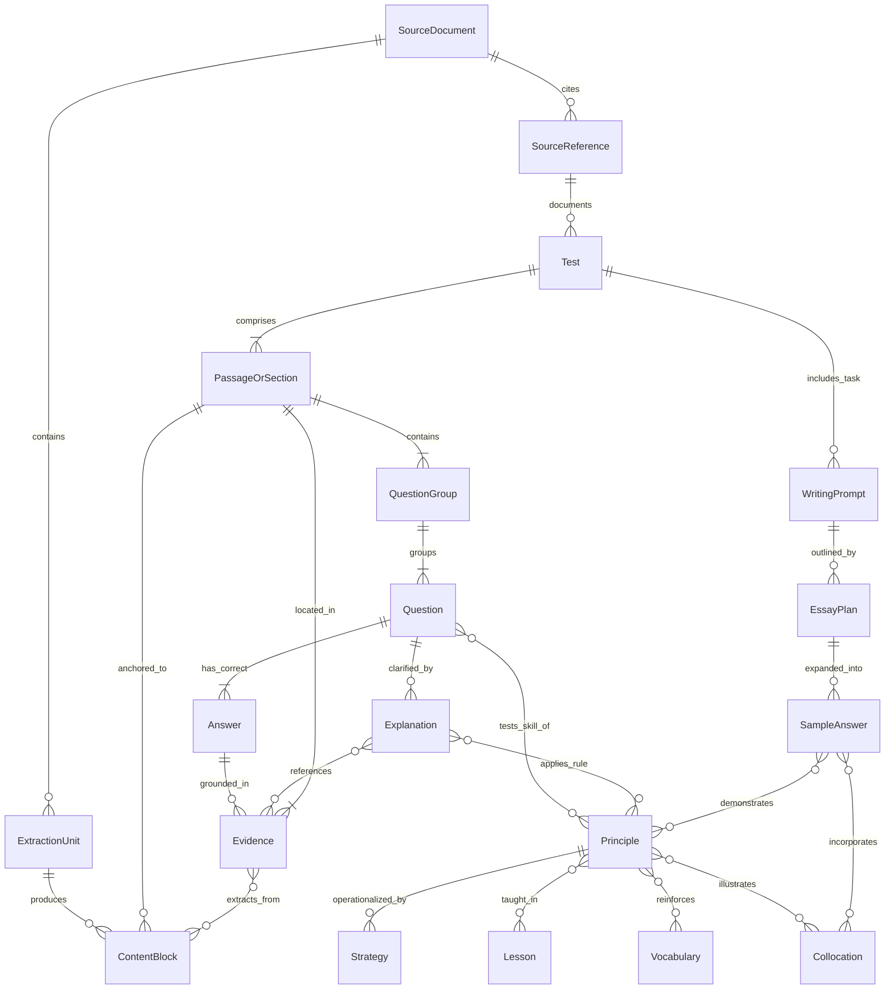

# IELTS Data Harness V0.2 — Entity Relationship Specification
**Phase V0.2-A: Schema Design & Normalization Contract**  
**Status:** Architectural Blueprint (Design Only)  
**Author:** IELTS Learning Systems Engineer & Data Architecture Team  
**Date:** 2026-11-19  

---

## 1. Domain Entity Catalog

The V0.2 normalized architecture categorizes all system entities into three cohesive domains: **Source & Provenance**, **Question Bank**, and **Learning Knowledge**.

```
┌────────────────────────────────────────────────────────────────────────────────────────┐
│                              IELTS DOMAIN ENTITY CATALOG                               │
├──────────────────────────┬─────────────────────────────┬───────────────────────────────┤
│   SOURCE & PROVENANCE    │        QUESTION BANK        │      LEARNING KNOWLEDGE       │
├──────────────────────────┼─────────────────────────────┼───────────────────────────────┤
│ • SourceDocument         │ • Test                      │ • Principle                   │
│ • SourceReference        │ • PassageOrSection          │ • Strategy                    │
│ • ExtractionUnit         │ • QuestionGroup             │ • Lesson                      │
│ • ContentBlock           │ • Question                  │ • Vocabulary                  │
│                          │ • Answer                    │ • Collocation                 │
│                          │ • Evidence                  │ • EssayPlan                   │
│                          │ • Explanation               │ • SampleAnswer                │
└──────────────────────────┴─────────────────────────────┴───────────────────────────────┘
```

---

## 2. Complete Entity-Relationship Model



---

## 3. Entity Definitions & Domain Specifications

### 3.1 Source & Provenance Domain

#### 3.1.1 `SourceDocument`
- **Definition:** Physical or digital file asset tracked in V0.1 inventory (`private/raw/`).
- **Primary Key:** `source_file_id` (e.g., `SRC-011`).
- **Key Attributes:** `file_path`, `content_sha256`, `size_bytes`, `extension`, `detected_type`, `collection`, `publication_permission`.
- **Role:** Immutable root of provenance. All downstream learning objects must maintain backward traceability to a `source_file_id`.

#### 3.1.2 `SourceReference`
- **Definition:** Bibliographic and contextual authority citation (e.g., "Cambridge IELTS Practice Tests Vol 1", "IELTS Academic Official Examination Papers").
- **Primary Key:** `reference_id` (e.g., `REF-CAMB-VOL01`).
- **Key Attributes:** `title`, `author_or_publisher`, `edition`, `publication_year`, `isbn_or_url`, `is_authoritative`.
- **Role:** Connects physical files to logical published works, enabling copyright and authority validation.

#### 3.1.3 `ExtractionUnit`
- **Definition:** The discrete processing partition processed by V0.1 extraction adapters (e.g., a specific PDF page, a Word document body, an Excel workbook sheet, or an audio metadata record).
- **Primary Key:** `unit_id` (e.g., `SRC-011:page_0001`, `SRC-138:raw_document`).
- **Key Attributes:** `source_file_id`, `unit_type` (`page`, `document`, `sheet`, `audio_metadata`), `unit_identifier` (`page_0001`), `adapter_name`, `adapter_version`.

#### 3.1.4 `ContentBlock`
- **Definition:** Atomic structural element of extracted text or media (a single paragraph, heading, table row, list item, or transcript dialogue segment).
- **Primary Key:** `block_id` (e.g., `BLK-SRC138-000309`).
- **Key Attributes:** `unit_id`, `block_type` (`paragraph`, `heading`, `table`, `list_item`, `transcript_line`), `block_index`, `raw_text`, `sanitized_text`, `bounding_box` (if OCR).

---

### 3.2 Question Bank Domain

#### 3.2.1 `Test`
- **Definition:** A complete IELTS practice examination unit or past paper.
- **Primary Key:** `test_id` (e.g., `TEST-IELTS-VOL01-01-ACAD`).
- **Key Attributes:** `reference_id`, `volume_number`, `test_number`, `track` (`academic` or `general_training`), `title`, `source_confidence`.

#### 3.2.2 `PassageOrSection`
- **Definition:** A bounded structural component within a test:
  - Reading: Passage 1, 2, or 3.
  - Listening: Section / Part 1, 2, 3, or 4.
- **Primary Key:** `passage_id` (e.g., `PASSAGE-VOL01-01-RD01`).
- **Key Attributes:** `test_id`, `skill` (`reading`, `listening`), `sequence_number` (1, 2, 3, or 4), `title`, `narrative_text`, `paragraph_map` (dict mapping paragraph labels `'A'`, `'B'`, `'C'` to character offsets), `word_count`, `audio_track_id` (for listening).

#### 3.2.3 `QuestionGroup`
- **Definition:** A cluster of questions that share the same rubrics, instructions, and target format.
- **Primary Key:** `group_id` (e.g., `QG-VOL01-01-RD01-G01`).
- **Key Attributes:** `passage_id`, `skill`, `question_type` (e.g., `true-false-not-given`, `sentence-completion`), `start_number` (e.g., 1), `end_number` (e.g., 6), `instruction_text`, `word_limit_rule` (`ONE WORD ONLY`, `NO MORE THAN TWO WORDS`), `shared_options` (if matching headings or matching features).

#### 3.2.4 `Question`
- **Definition:** An individual test item presenting a specific task or proposition.
- **Primary Key:** `question_id` (e.g., `Q-VOL01-01-RD-001`).
- **Key Attributes:** `group_id`, `passage_id`, `question_number` (1 to 40), `question_type`, `prompt_text`, `options` (for MCQ, e.g. `{"A": "...", "B": "..."}`), `target_blank_index` (for sentence completions).

#### 3.2.5 `Answer`
- **Definition:** The ground-truth acceptable response(s) for a question.
- **Primary Key:** `answer_id` (e.g., `ANS-VOL01-01-RD-001-KEY`).
- **Key Attributes:** `question_id`, `primary_target` (`"TRUE"`, `"white"`, `"B"`), `acceptable_alternates` (`["FALSE", "F"]` or `["center", "centre"]`), `case_sensitive` (boolean), `verification_status` (`authoritative_key`, `consensus_key`, `unverified`, `disputed`), `source_key_ref`.

#### 3.2.6 `Evidence`
- **Definition:** The exact textual excerpt or audio bounding interval that proves or disproves the proposition in the question.
- **Primary Key:** `evidence_id` (e.g., `EVID-VOL01-01-RD-001-01`).
- **Key Attributes:** `answer_id`, `passage_id`, `paragraph_label` (`"A"`, `"B"`, etc.), `char_start`, `char_end`, `verbatim_quote`, `exact_match_verified` (boolean), `audio_start_sec`, `audio_end_sec`.

#### 3.2.7 `Explanation`
- **Definition:** The structured pedagogical reasoning elucidating why the answer is correct, how distractors fail, and which lexical paraphrases operate between prompt and passage.
- **Primary Key:** `explanation_id` (e.g., `EXPL-VOL01-01-RD-001`).
- **Key Attributes:** `question_id`, `answer_id`, `evidence_id`, `rationale_en`, `rationale_vi`, `paraphrase_pairs` (list of `{"prompt_phrase": "...", "passage_phrase": "..."}`), `distractor_analysis`, `explanation_source` (`source_provided`, `expert_verified`, `machine_drafted_unverified`), `verification_status`.

---

### 3.3 Learning Knowledge Domain

#### 3.3.1 `Principle`
- **Definition:** An atomic, reusable cognitive rule or verification methodology governing exam performance (e.g., `RD-TFNG-001`).
- **Primary Key:** `principle_id` (e.g., `RD-TFNG-001`, `RD-MI-001`).
- **Storage:** Git-tracked Markdown file under `principles/{skill}/{category}/{slug}.md`.
- **Key Attributes:** `title`, `type` (`principle`, `strategy`, `heuristic`), `skill`, `question_types`, `triggers` (observable error codes), `status` (`draft`, `verified`), `transfer_exercise`.

#### 3.3.2 `Strategy`
- **Definition:** An operational procedure detailing the step-by-step execution protocol for a specific question type or essay task.
- **Primary Key:** `strategy_id` (e.g., `STRAT-RD-TFNG-STEPWISE`).
- **Key Attributes:** `principle_id`, `skill`, `question_type`, `step_sequence` (ordered array of cognitive operations), `time_budget_sec`.

#### 3.3.3 `Lesson`
- **Definition:** A pedagogical unit synthesizing multiple principles, lexical banks, and worked examples into an instructional sequence.
- **Primary Key:** `lesson_id` (e.g., `LES-RD-TFNG-MASTERY`).
- **Key Attributes:** `title`, `skill`, `target_band`, `prerequisite_principles`, `guided_questions`, `summary_vi`.

#### 3.3.4 `Vocabulary` & `Collocation`
- **Definition:** High-yield academic lexical items extracted from authentic reading/listening passages or model writing essays.
- **Primary Key:** `vocab_id` (e.g., `VOC-ACAD-00042`) / `colloc_id` (e.g., `COL-ACAD-00018`).
- **Key Attributes:** `lemma_or_expression`, `cambridge_us_ipa`, `pos`, `cefr_level` (`B2`, `C1`, `C2`), `meaning_vi`, `context_sentence_en`, `source_passage_id`.

#### 3.3.5 `WritingPrompt`, `EssayPlan` & `SampleAnswer`
- **Definition:** Writing Task 1/2 pedagogical chain.
- **Primary Keys:** `prompt_id` $\to$ `plan_id` $\to$ `sample_id`.
- **Key Attributes:**
  - `WritingPrompt`: `task_type` (`task1_process`, `task2_agree_disagree`), `prompt_text`, `stimulus_image_path`.
  - `EssayPlan`: `thesis_statement`, `body1_focus`, `body2_focus`, `cohesive_progression`.
  - `SampleAnswer`: `full_text`, `word_count`, `band_estimate` (`7.5`, `8.0`), `criterion_scores` (`TR`, `CC`, `LR`, `GRA`), `annotated_features`.

---

## 4. Referential Integrity & Relationship Matrix

| Source Entity | Target Entity | Cardinality | Foreign Key Name | On Delete | On Update | Unresolved / Orphan Handling Rule |
|---|---|---|---|---|---|---|
| `ExtractionUnit` | `SourceDocument` | N : 1 | `source_file_id` | RESTRICT | CASCADE | Units must point to valid inventoried file in `sources` table. |
| `ContentBlock` | `ExtractionUnit` | N : 1 | `unit_id` | CASCADE | CASCADE | Deleting extraction unit cascades to extracted content blocks. |
| `PassageOrSection` | `Test` | N : 1 | `test_id` | RESTRICT | CASCADE | Standalone passages must be attached to an omnibus or modular test ID. |
| `QuestionGroup` | `PassageOrSection` | N : 1 | `passage_id` | CASCADE | CASCADE | Question groups belong strictly to a passage or section. |
| `Question` | `QuestionGroup` | N : 1 | `group_id` | CASCADE | CASCADE | Every question must belong to an instruction group. |
| `Answer` | `Question` | N : 1 | `question_id` | CASCADE | CASCADE | Multiple answers permitted for alternative spellings or interpretations. |
| `Evidence` | `Answer` | N : 1 | `answer_id` | CASCADE | CASCADE | Multiple evidence spans permitted if answer is reinforced in multiple lines. |
| `Evidence` | `PassageOrSection` | N : 1 | `passage_id` | RESTRICT | CASCADE | Evidence must cite valid passage. If passage is unextracted, mark `unlinked`. |
| `Explanation` | `Question` | N : 1 | `question_id` | CASCADE | CASCADE | Explanation belongs to question item. |
| `Explanation` | `Evidence` | N : 1 | `evidence_id` | SET NULL | CASCADE | If evidence is not yet anchored, explanation remains valid but ungrounded. |
| `Explanation` | `Principle` | N : M | `principle_id` | SET NULL | CASCADE | Maintained via join table `explanation_principles`. Nullable if unmapped. |
| `Question` | `Principle` | N : M | `principle_id` | SET NULL | CASCADE | Maintained via join table `question_principles`. Mapped via error triggers. |
| `EssayPlan` | `WritingPrompt` | N : 1 | `prompt_id` | CASCADE | CASCADE | Plan outlines a specific task prompt. |
| `SampleAnswer` | `EssayPlan` | N : 1 | `plan_id` | CASCADE | CASCADE | Model essay expands a specific essay plan. |

---

## 5. Unresolved References & Orphan Reconciliation Policy

Real-world test archives frequently exhibit incomplete document splits (e.g., VOL 7 has answer keys for Tests 1–10 in `SRC-151`, but the question booklets are missing from the volume). The V0.2 relational model enforces these strict handling rules:

1. **Orphaned Answer Keys:**
   When an answer key exists without a matching question booklet, the answer record is ingested with `question_id: null` and `target_placeholder: "VOL07-T01-Q01"`, assigned `verification_status: "review_required"`, and flagged with `unresolved_parent_question`.
2. **Orphaned Questions:**
   When a question booklet is extracted without an answer key (e.g., VOL 3 Test 10 in `SRC-079`), the question is ingested with `answer_id: null` and flagged with `missing_answer_key`. It is **never** populated by guessing.
3. **Orphaned Explanations:**
   When an explanation book cites questions that are partially scanned (e.g., `SRC-137` missing Question 1), the explanation is stored with a null foreign key and logged in the reconciliation report.
